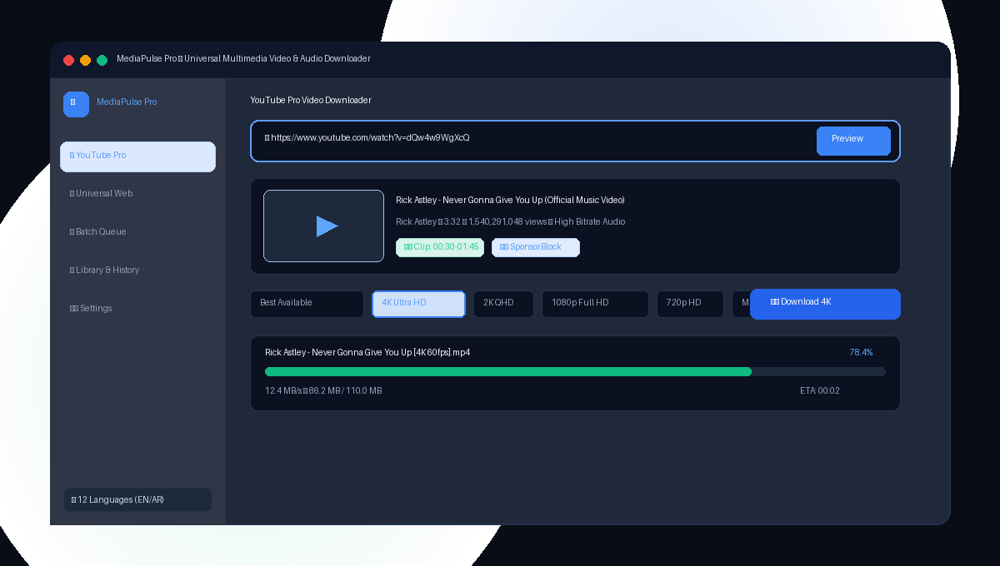

# ⚡ MediaPulse Pro — Universal Multimedia Video & Audio Downloader

[](https://github.com/MediaPulse/MediaPulsePro/actions/workflows/release.yml)
[](https://github.com/MediaPulse/MediaPulsePro/releases)
[](LICENSE)
[](https://microsoft.com)
[](https://github.com/yt-dlp/yt-dlp)
[](https://ffmpeg.org)

A high-performance, hardened, privacy-focused multimedia video and audio downloader for Windows. Engineered with a dark glassmorphism interface, native multi-language internationalization (including full right-to-left Arabic support), sequential batch processing, and embedded media stream reconstruction.

<p align="center">
  
</p>

---

## 🌟 Key Highlights & Features

### 📺 1. YouTube Pro
- **High-Definition Video**: Download in 4K Ultra HD (2160p), 2K QHD (1440p), 1080p 60fps Full HD, and 720p HD.
- **Studio Audio Extraction**: One-click pure audio conversion to 320kbps MP3, M4A, WAV, FLAC, and OPUS.
- **Pre-Download Link Preview**: High-resolution thumbnail, channel badges, view counts, and duration metadata preview.
- **Full YouTube Playlist Engine**: Instant flat-mode extraction without freezing UI; scrollable checklist with thumbnails, durations, and channels; Select All / Select None controls; custom range selector (e.g. `1-10` or `5,8,12`); single-video-in-playlist prompt; subfolder creation; optional position index prefixing (`01 - Title`); skipping existing files to resume interrupted playlists; and skipping private/deleted/region-blocked videos with clean short alerts.
- **Subtitles & Metadata**: Embed subtitles (`all`, `en`, `ar`, etc.) and album art/chapters directly into media containers.
- **SponsorBlock Integration**: Automatically detect and skip sponsored segments, intros, and promotional fillers.
- **Video Trimmer**: Extract only a specific time range (`start_time` - `end_time`) with frame accuracy without downloading entire streams.

### 🌐 2. Universal Web Sniffer (1,800+ Websites)
- **Extensive Platform Support**: Seamless downloads from Instagram Reels, TikTok, Twitter/X, Facebook, Vimeo, Reddit, Twitch, Dailymotion, Rumble, and Bilibili.
- **Automatic Browser Cookie Authentication**: Bypasses login walls and rate limits using active session cookies from your installed browser (Firefox, Edge, Chrome, Brave, Opera).
- **Social URL Sanitization**: Automatically normalizes mobile/share URLs (e.g. `/reels/` -> `/reel/`) and strips tracking queries.
- **Deep HTML5 / Stream Sniffer**: Scans any generic webpage for direct `<video src="...">`, HLS streaming playlists (`.m3u8`), and DASH manifests (`.mpd`).

### 📋 3. Batch Queue & Reordering
- **Sequential Multi-Item Queue**: Paste multiple links at once to queue them for background sequential downloading.
- **Drag-to-Reorder**: Reorder queued downloads with interactive drag handles or move buttons.
- **Pause & Resume**: Safe pause and resume without corrupting partially downloaded fragments.
- **Connection Recovery**: Automatic resumption (`continuedl`) with up to 10 retry attempts for interrupted transfers.

### 🌍 4. Complete Internationalization (i18n & RTL)
- **12 Supported Languages**:
  - English (`en`)
  - Arabic (`ar`) — authentic right-to-left (`dir="rtl"`) UI layout, typography, and mirrored interface
  - French (`fr`)
  - Spanish (`es`)
  - German (`de`)
  - Portuguese (`pt`)
  - Turkish (`tr`)
  - Russian (`ru`)
  - Chinese Simplified (`zh`)
  - Japanese (`ja`)
  - Hindi (`hi`)
  - Indonesian (`id`)
- **Zero Hardcoded Strings**: All text resides in clean, standalone JSON files in `locales/`.
- **Instant In-App Switching**: Switch languages in 1-click from the header or Settings without restarting.
- **System Language Auto-Detection**: Automatically detects Windows display language on first launch.

### ⚙️ 5. Settings, Auto-Updater & Embedded FFmpeg 7.1
- **Custom Download Folder & Filename Templates**: Choose your target directory with native Windows folder dialogs; customize naming patterns (e.g. `%(title)s [%(id)s].%(ext)s`).
- **Speed Limiter & Proxy**: Throttle download speed (1 MB/s, 2 MB/s, 5 MB/s) or configure HTTP/SOCKS5 proxies.
- **In-App yt-dlp Updater**: Background check on startup and 1-click in-app updating from PyPI.
- **FFmpeg 7.1 Diagnostics & Auto-Downloader**: Discovers bundled FFmpeg or downloads static binaries on demand with live progress reporting.
- **Clipboard Link Watcher**: Detects copied multimedia links and displays non-intrusive download alerts.
- **High-DPI Awareness**: Explicit Per-Monitor DPI awareness (`SetProcessDpiAwareness(2)`) and Windows `AppUserModelID` for clean taskbar grouping.

---

## 📥 Installation & Download

### Windows Pre-compiled Release
Download the latest pre-compiled release from the [GitHub Releases](https://github.com/MediaPulse/MediaPulsePro/releases) page:

1. **Standalone Folder Distribution (Recommended)**:
   - Download `MediaPulsePro-v1.1.0-Windows-x64.zip`.
   - Extract the folder and double-click `MediaPulsePro.exe`.
   - No external Python installation required; FFmpeg and WebView2 dependencies are included.
2. **Windows Installer**:
   - Download `MediaPulsePro_Setup_v1.1.0.exe` for automated Start Menu and Desktop shortcuts.

---

## 🚀 Running from Source

If you prefer to run or build the application from source code:

```powershell
# 1. Clone repository
git clone https://github.com/MediaPulse/MediaPulsePro.git
cd MediaPulsePro

# 2. Create clean virtual environment
python -m venv .venv
.venv\Scripts\Activate.ps1

# 3. Install dependencies
pip install -r requirements.txt
pip install pytest httpx pyinstaller pillow

# 4. Run the modern desktop app
python desktop_app.py
```

---

## 🧪 Automated Test Suite

MediaPulse Pro includes a comprehensive automated test suite under `tests/` powered by `pytest`.

```powershell
# Run the fast unit test suite (38+ tests)
pytest tests -m "not slow" -v

# Run the complete test suite including real integration tests
pytest tests -v
```

### Coverage Highlights:
| Test Scenario | Module | Status |
| :--- | :--- | :--- |
| **YouTube Playlist (Flat, Range, Resume, Skip)** | `tests/test_playlist.py` | ✅ PASSED |
| **Single Video in Playlist Detection & Choice** | `tests/test_playlist.py` | ✅ PASSED |
| **URL Validation & Normalization** | `tests/test_url_and_metadata.py` | ✅ PASSED |
| **Instagram Reels & Cookies** | `tests/test_url_and_metadata.py` | ✅ PASSED |
| **All 12 Languages & Key Parity** | `tests/test_i18n.py` | ✅ PASSED |
| **Arabic RTL & Translation Quality** | `tests/test_i18n.py` | ✅ PASSED |
| **Network Loss & Auto-Resume** | `tests/test_download_failures_and_edge_cases.py` | ✅ PASSED |
| **Unicode & Emoji Filenames** | `tests/test_download_failures_and_edge_cases.py` | ✅ PASSED |
| **Batch Queue & Reordering** | `tests/test_queue_and_pause_resume.py` | ✅ PASSED |
| **Single-Instance Mutex** | `tests/test_ui_and_lifecycle.py` | ✅ PASSED |
| **FastAPI REST Bridge** | `tests/test_api_and_bridge.py` | ✅ PASSED |

---

## 📦 Building Executable & Installer

```powershell
# Automated build script (runs tests, bundles assets & compiles)
.\build.bat
```

To compile the Inno Setup installer:
```powershell
iscc.exe installer.iss
```

---

## ⚖️ Legal Disclaimer & Terms

- **Intended Use**: MediaPulse Pro is strictly intended for downloading authorized, personal, educational, and public domain media with explicit permission from content creators.
- **No DRM Circumvention**: MediaPulse Pro does not bypass, disable, or circumvent Digital Rights Management (DRM) or technological protection measures.
- **Compliance**: Users are solely responsible for complying with the terms of service of any third-party website and applicable copyright laws in their respective jurisdiction.

---

## 📄 License & Attributions

- Distributed under the [MIT License](LICENSE).
- Third-party components, tools, and libraries are attributed in [THIRD_PARTY_NOTICES.md](THIRD_PARTY_NOTICES.md).
